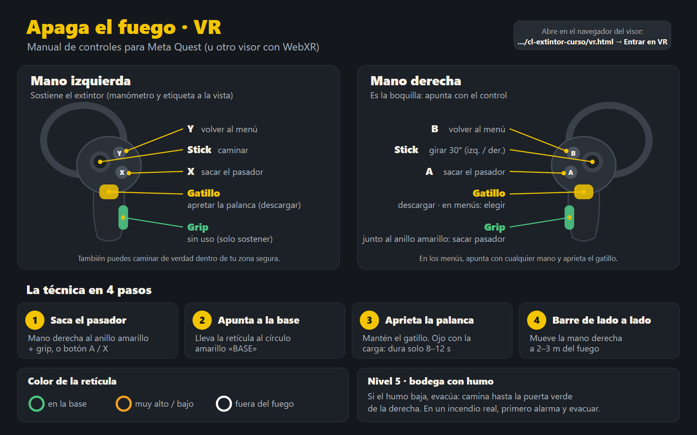

# Apaga el fuego 🧯

Juego web de entrenamiento en el uso del extintor. Aplica la técnica de 4 pasos:

1. Saca el pasador
2. Apunta a la base del fuego
3. Aprieta la palanca
4. Barre de lado a lado, a 2–3 m

## Niveles

| # | Escenario | Clase de fuego |
|---|-----------|----------------|
| 1 | Oficina – papelero en llamas | A |
| 2 | Sala de servidores – rack energizado | C |
| 3 | Casino / cocina – sartén con aceite | K |
| 4 | Taller – líquido inflamable | B |
| 5 | Bodega con humo – ¿apagar o evacuar? | A |

## Controles

- **Móvil:** arrastra para apuntar, mantén *Apretar* para descargar, botones ▲/▼ para acercarte o alejarte.
- **Computador:** mouse para apuntar, clic o barra espaciadora para descargar.

## Jugar

Abre `index.html` en el navegador. No requiere instalación ni dependencias.

### Publicar con GitHub Pages

1. Sube el repositorio a GitHub.
2. En **Settings → Pages**, elige *Deploy from a branch*, rama `main`, carpeta `/ (root)`.
3. El juego quedará en `https://<usuario>.github.io/<repositorio>/`.

## Modo realidad virtual (WebXR)

`vr.html` es la versión 3D para visores como Meta Quest. Usa las mismas reglas y comparte el progreso con la versión 2D.

1. Abre `https://<usuario>.github.io/<repositorio>/vr.html` en el navegador del visor. WebXR exige HTTPS, y GitHub Pages ya lo usa.
2. Pulsa **Entrar en VR**.

| Acción | Control |
|--------|---------|
| Sostener el extintor | Mano izquierda |
| Apuntar la boquilla | Mano derecha |
| Sacar el pasador | Acerca la mano derecha al anillo amarillo y aprieta el *grip* (o botón A/X) |
| Apretar la palanca | Gatillo |
| Caminar / girar | Stick izquierdo / stick derecho |
| Evacuar (nivel 5) | Camina hasta la puerta verde |
| Volver al menú | Botón B/Y |
| Salir de VR | Menú → botón «Salir de VR» (o el botón Meta) |

### Realidad mixta (el fuego en tu casa)

En el Quest aparece también el botón **Realidad mixta (tu casa)**: se ve tu entorno real a través
de las cámaras del visor (passthrough) y el fuego aparece a ~2,6 m frente a ti, sin paredes virtuales.
Despeja el espacio antes de jugar: el extintor y el fuego son virtuales, pero tú te mueves en tu casa real.



Sin visor también se puede probar en el computador con mouse y teclado.

## Estructura

```
index.html      # estructura de la página
css/style.css   # estilos
js/game.js      # lógica del juego, audio y escenas (canvas)
vr.html         # versión WebXR
js/vr.js        # escenario 3D, controles VR y reglas (Three.js desde CDN)
```

> En un incendio real, primero da la alarma y evacúa. Combate solo un fuego pequeño, si sabes cómo hacerlo y tienes la salida despejada a tu espalda.
